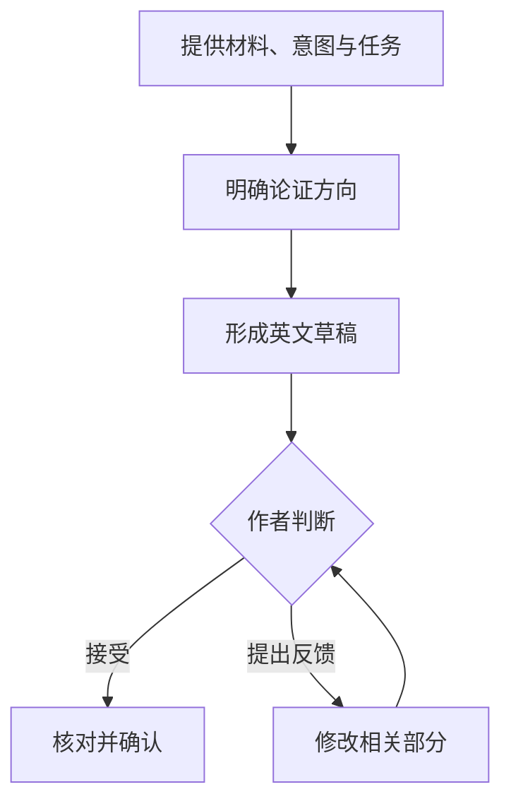

<div align="center">

# Medical Review Editor

**协助起草、重构和修改医学综述，在形成自然学术表达的同时，保留作者的论证、术语、证据强度与引用关系。**


从资料与写作意图出发，组织论证、形成英文，并根据作者反馈继续完善。

**[English](README.md) · 简体中文**

</div>

## 📑 目录

- [可以完成哪些工作](#可以完成哪些工作)
- [一次完整的写作协作](#一次完整的写作协作)
- [安装与首次使用](#安装与首次使用)
- [按任务开始使用](#按任务开始使用)
- [怎样参与写作过程](#怎样参与写作过程)
- [协作与进阶使用](#协作与进阶使用)
- [许可证](#许可证)

<a id="可以完成哪些工作"></a>

## ✨ 可以完成哪些工作

医学综述写作需要同时处理内容与表达：确定一段文字要建立什么观点，安排证据与推理，再将它们写成准确、自然的英文。

`medical-review-editor` 围绕这些工作提供协助：

| 任务 | 提供什么 | 获得什么 |
|---|---|---|
| **起草段落或章节** | 提纲、资料、希望表达的观点 | 有论证组织的英文草稿及简短说明 |
| **中文综述英文重构** | 中文原文、术语和修改要求 | 保留作者含义与论证顺序的英文 |
| **英文修改与表达比较** | 现有英文、修改范围 | 修订文本或医学含义一致的表达候选 |
| **论证与结构梳理** | 段落、章节或写作框架 | 内容安排、逻辑关系与修改建议 |
| **观点与证据强度校准** | 文字及允许使用的证据 | 更准确的主张、科学动作与限定表达 |
| **独立组件写作** | 稿件内容、组件用途及格式要求 | 摘要、标题、短标题、Highlights、关键词等 |
| **正文与图表对照** | 正文、图表、图注或算法 | 不一致之处及对应修改建议 |
| **审稿回复与期刊适配** | 审稿意见或已确定的期刊要求 | 修改策略、回复内容或授权范围内的文本调整 |

### 写作过程中重点保留什么？

- **作者观点与论证关系**：因果、条件、对比、递进和综合判断。
- **医学信息**：研究对象、临床条件、干预、结局和时间。
- **术语与证据强度**：保持概念一致，准确表达观察、解释与建议。
- **引用归属**：拆分或合并句子时，让引用继续支持对应的主张。
- **已经确认的选择**：根据新的反馈修改相关部分，保留满意的内容。

<a id="一次完整的写作协作"></a>

## 🔎 一次完整的写作协作

### 从两份资料到一个英文综述段落

下面的案例展示一次实际完成的协作：

**提供资料与意图 → 确认论证安排 → 起草英文 → 作者确认 → 核对并保存。**

案例使用合成资料。标志物 M、功能恢复评分 FRS 和资料编号 `[S1]`、`[S2]` 均为演示设定。

### ① 输入：资料与写作意图

| 资料 | 内容 |
|---|---|
| **S1** | 单中心回顾性研究，80 名择期腹部手术成人患者；术后 48 小时测量 M，4 周时评估 FRS；调整年龄和术前功能评分后，较高 M 仍与较低 FRS 相关 |
| **S2** | 前瞻性观察研究，120 名同类成人患者；采用相同测量时间，观察到相同方向的关联 |
| **术语定义** | FRS 越高表示功能恢复越好 |
| **证据范围** | 两项研究均未评价预测模型表现，也未检验依据 M 调整干预的效果 |

作者希望本段表达：

> 两项研究方向一致，为继续研究 M 与恢复差异的关系提供依据；下一步应关注它是否具有预测价值。

### ② 设计：先明确段落怎样建立观点

确认的论证顺序是：

| 位置 | 段落承担的工作 |
|---|---|
| 开头 | 综合两项研究共同观察到的关联 |
| 中间 | 交代研究设计、人数、时间及调整结果，并保留各自引用 |
| 后半段 | 解释这些观察对后续研究的意义 |
| 结尾 | 将下一步问题落在预测价值的评价上 |

### ③ 输出：形成完整英文

> Two observational studies have reported an association between higher early postoperative levels of marker M and poorer functional recovery four weeks after elective abdominal surgery in adults. In a single-center retrospective study of 80 patients, M levels measured 48 hours after surgery were associated with lower functional recovery score (FRS) values at four weeks. This association persisted after adjustment for age and preoperative FRS [S1]. A prospective observational study of 120 patients undergoing the same category of surgery reported an association in the same direction using the same measurement schedule [S2]. These concordant findings support further investigation of M as a candidate marker of differences in postoperative recovery. The next step is to evaluate its predictive performance, distinguishing the observed association from its potential use in predicting individual recovery outcomes.

作者确认接受这份 130 词的第一稿，随后保存为最终文本。

### ④ 核对：让结果与输入对应

| 需要保留的内容 | 成稿中的对应处理 |
|---|---|
| 研究设计与人数 | 保留回顾性研究的 80 人与前瞻性观察研究的 120 人 |
| 测量时间 | 保留术后 48 小时和 4 周 |
| 调整条件 | 保留年龄与术前 FRS |
| 关联方向 | 较高 M 对应较低 FRS，并解释为较差的功能恢复 |
| 引用归属 | `[S1]`、`[S2]` 分别位于对应研究描述之后 |
| 综合判断 | 将观察结果转化为后续研究依据，结尾提出预测性能评价 |

📂 **查看完整案例：** [输入资料](examples/writing-collaboration/inputs.md) · [任务请求](examples/writing-collaboration/task.md) · [确认后的英文](examples/writing-collaboration/result.md) · [核对记录](examples/writing-collaboration/verification.md)

<a id="安装与首次使用"></a>

## 🚀 安装与首次使用

### 1. 安装 Skill

将包含 `SKILL.md` 的完整文件夹放到个人 Skills 目录：

```text
~/.agents/skills/medical-review-editor/
```

Windows 路径示例：

```text
C:\Users\<用户名>\.agents\skills\medical-review-editor\
```

目录结构：

```text
medical-review-editor/
├── SKILL.md
├── agents/
├── references/
└── evaluation/
```

### 2. 准备写作材料

从当前任务需要的内容开始即可：

| 材料 | 示例 |
|---|---|
| 要处理的内容 | 一段文字、一个章节提纲或几份资料摘要 |
| 希望完成的任务 | 起草、英文重构、局部修改、结构讨论或核对 |
| 作者意图 | 这一段希望读者理解什么 |
| 使用要求 | 术语、引用、篇幅、期刊要求或允许调整的范围 |

已有明确材料与要求时，可以直接请求写作；希望先讨论方向时，可以先请求论证安排。

### 3. 开始第一次协作

在 Codex 中输入：

```text
使用 $medical-review-editor，根据以下资料起草一个医学综述段落。

段落用途：
……

希望表达的核心观点：
……

允许使用的资料与引用：
……

请先提出简短的论证安排，确认后起草英文。
保留研究条件、术语、证据强度和引用归属。
```

如果论证安排已经确定，也可以直接说明：

> “以下方向已经确认，请据此起草英文，并简要说明关键表达选择。”

<a id="按任务开始使用"></a>

## ✍️ 按任务开始使用

### 根据资料与观点起草英文

适合已经确定段落用途，希望将资料组织成连续论述的任务。

```text
使用 $medical-review-editor 起草一个 Discussion 段落。

核心观点、论证顺序和资料如下：
……

请综合组织资料，形成完整英文。
保留条件限定与引用，并简要说明论证和表达上的处理。
```

### 将中文综述重构为英文

适合已有中文原文，希望保留作者推理，同时改善英文句法与衔接的任务。

```text
使用 $medical-review-editor，将以下中文综述重构为英文。

请保留观点、论证顺序、医学条件和引用归属，
允许调整句法、拆分句子并改善衔接。

术语要求：
……

中文原文：
……
```

### 在明确范围内修改已有英文

适合已经有草稿，希望处理特定问题的任务。

```text
使用 $medical-review-editor 修改以下英文段落。

本次只处理：
句间衔接、指代和语法问题。

已经确认需要保留：
……

请提供修订文本和简短理由；
将必要修正与可选表达建议分别说明。
```

需要比较不同表达时，可以补充：

> “请给出三种医学含义、证据强度和引用归属一致的表达，说明各自适合的语气或上下文。”

<a id="怎样参与写作过程"></a>

## 🔄 怎样参与写作过程



这是一条常见的协作路径。任务和方向明确时，可以直接进入起草；需要讨论结构时，再先安排论证。

### 提出具体反馈

反馈可以围绕内容功能、表达重点或修改范围：

> “第二句应更突出调整后的结果，其他内容保留。”

> “这段要讨论研究意义，机制背景已经在上一段解释过。”

> “保留当前论证顺序，只改善英文衔接。”

> “这版内容已经确认，接下来只核对术语和引用。”

### 获得与任务对应的结果

| 当前任务 | 常见产出 |
|---|---|
| 讨论方向 | 简短的结构或论证安排 |
| 起草与重构 | 完整英文及中文说明 |
| 比较表达 | 若干等义候选及差异说明 |
| 审阅与核对 | 具体问题、必要修正和可选建议 |
| 局部修订 | 修改后的相关文本及调整理由 |

<a id="协作与进阶使用"></a>

## 🛠️ 协作与进阶使用

`medical-review-editor` 可以独立完成核心医学写作与编辑任务。

当任务涉及作者表达、模板模式诊断等相邻工作时，可以在已安装、任务适配且用户授权允许的情况下，与 `academic-humanizer` 协作。交接时保留原文、作者意图、术语、引用和允许修改的范围。

<details>
<summary><strong>查看各类任务的详细规则</strong></summary>

- [结构与段落组织](references/structure-and-prose.md)：明确章节功能，安排论证与内容。
- [语言与术语](references/language-and-terminology.md)：重构英文句法，保持术语、缩写与引用一致。
- [观点与证据强度](references/claim-calibration.md)：准确表达观察、解释、比较和建议。
- [科学表达与用词](references/scientific-expression.md)：结合语义和上下文改善表达。
- [独立组件](references/component-contracts.md)：处理摘要、标题、Highlights 等写作任务。
- [图表与正文对照](references/visual-table-alignment.md)：检查文字与视觉内容的对应关系。
- [审阅输出](references/audit-output.md)：组织发现、修正与建议。
- [审稿回复](references/reviewer-response.md)：理解意见并制定回应与修改策略。

</details>

<a id="许可证"></a>

## 📄 许可证

本项目采用 [MIT License](LICENSE)。
