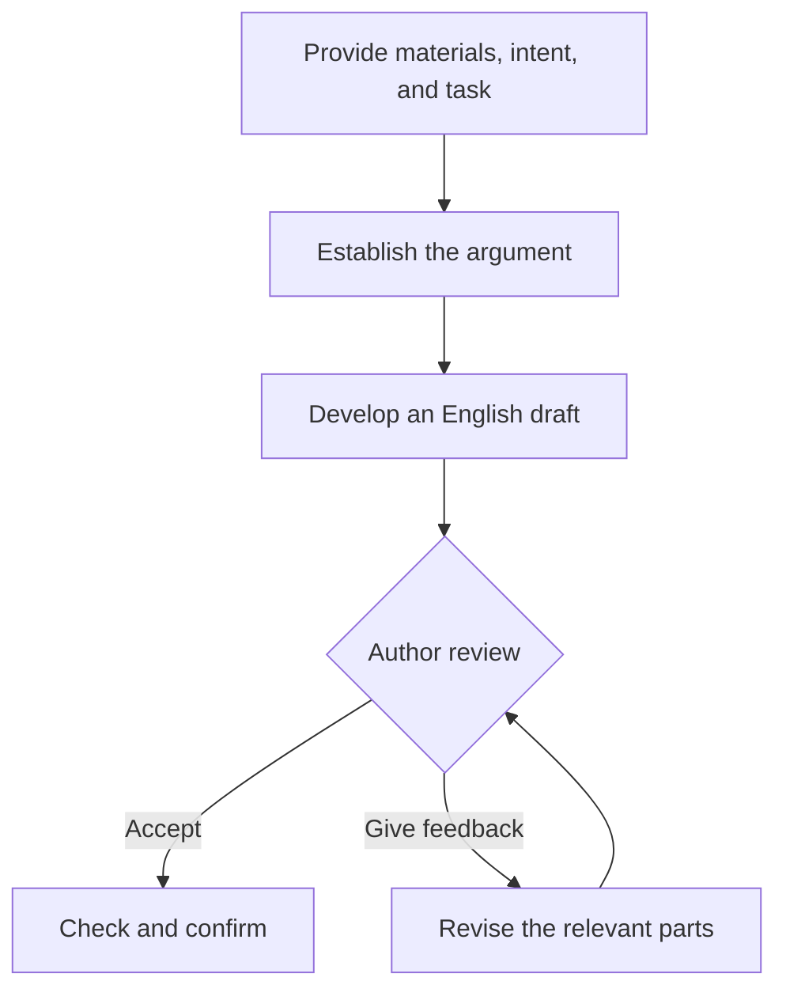

<div align="center">

# Medical Review Editor

**Draft, reconstruct, and revise medical reviews while preserving the author's reasoning, terminology, evidence strength, and citation relationships.**


Start with source materials and writing goals, organize the argument, develop clear academic English, and refine it through author feedback.

**English · [简体中文](README-ZH.md)**

</div>

## 📑 Contents

- [What you can do](#what-you-can-do)
- [A complete writing collaboration](#a-complete-writing-collaboration)
- [Installation and first use](#installation-and-first-use)
- [Start with your task](#start-with-your-task)
- [Participate in the writing process](#participate-in-the-writing-process)
- [Collaboration and advanced use](#collaboration-and-advanced-use)
- [License](#license)

<a id="what-you-can-do"></a>

## ✨ What you can do

Writing a medical review involves both content and expression: deciding what a passage should establish, organizing evidence and reasoning, and turning them into accurate, natural English.

`medical-review-editor` supports these tasks:

| Task | Provide | Receive |
|---|---|---|
| **Draft a paragraph or section** | An outline, source materials, and the intended argument | An organized English draft with a brief explanation |
| **Reconstruct Chinese review text in English** | Chinese prose, terminology, and editing requirements | English that preserves the author's meaning and reasoning sequence |
| **Revise English or compare expressions** | Existing prose and the permitted editing scope | Revised text or medically equivalent wording options |
| **Develop structure and reasoning** | A passage, section, or writing framework | Content organization, logical relationships, and revision suggestions |
| **Calibrate claims to evidence** | Prose and the evidence permitted for the task | More precise claims, scientific verbs, and qualifications |
| **Write individual manuscript components** | Manuscript content, component purpose, and format requirements | Abstracts, titles, running titles, highlights, keywords, and related components |
| **Check text against figures and tables** | Prose, figures, tables, legends, or algorithms | Identified inconsistencies and corresponding suggestions |
| **Address reviewer comments or journal requirements** | Reviewer feedback or requirements for a selected journal | Revision strategies, response text, or changes within the authorized scope |

### What does the writing process preserve?

- **Author meaning and reasoning:** causal, conditional, contrasting, sequential, and synthesis relationships.
- **Medical information:** populations, clinical conditions, interventions, outcomes, and timing.
- **Terminology and evidence strength:** consistent concepts and accurate distinctions among observations, interpretations, and recommendations.
- **Citation relationships:** citations remain attached to the claims they support when sentences are split or combined.
- **Confirmed choices:** feedback guides changes to the relevant parts while retaining accepted content.

<a id="a-complete-writing-collaboration"></a>

## 🔎 A complete writing collaboration

### From two source summaries to an English review paragraph

The following example records a completed collaboration:

**Provide materials and intent → Approve the argument → Draft in English → Obtain author acceptance → Check and save.**

The materials are synthetic. Marker M, the functional recovery score FRS, and source identifiers `[S1]` and `[S2]` are demonstration constructs.

### ① Input: source materials and writing intent

| Material | Content |
|---|---|
| **S1** | A single-center retrospective study of 80 adults undergoing elective abdominal surgery; M measured 48 hours after surgery and FRS assessed at four weeks; higher M remained associated with lower FRS after adjustment for age and preoperative functional score |
| **S2** | A prospective observational study of 120 adults undergoing the same category of surgery; the same measurement schedule and an association in the same direction |
| **Terminology** | Higher FRS indicates better functional recovery |
| **Evidence scope** | Neither study evaluated predictive model performance or tested the effects of adjusting interventions according to M |

The author's intended point was:

> Findings in the same direction support further investigation of M and differences in recovery. The next question is whether M has predictive value.

### ② Design: establish how the paragraph builds its argument

The approved sequence was:

| Position | Function |
|---|---|
| Opening | Synthesize the association observed in both studies |
| Middle | Present study designs, sample sizes, timing, and adjusted findings with their respective citations |
| Later sentences | Explain the implications for further research |
| Ending | Identify evaluation of predictive value as the next question |

### ③ Output: develop the English paragraph

> Two observational studies have reported an association between higher early postoperative levels of marker M and poorer functional recovery four weeks after elective abdominal surgery in adults. In a single-center retrospective study of 80 patients, M levels measured 48 hours after surgery were associated with lower functional recovery score (FRS) values at four weeks. This association persisted after adjustment for age and preoperative FRS [S1]. A prospective observational study of 120 patients undergoing the same category of surgery reported an association in the same direction using the same measurement schedule [S2]. These concordant findings support further investigation of M as a candidate marker of differences in postoperative recovery. The next step is to evaluate its predictive performance, distinguishing the observed association from its potential use in predicting individual recovery outcomes.

The author accepted this 130-word first draft, which was then saved as the final text.

### ④ Check: trace the result back to the inputs

| Content to preserve | Treatment in the final paragraph |
|---|---|
| Study designs and sample sizes | Retains 80 patients in the retrospective study and 120 in the prospective observational study |
| Measurement timing | Retains 48 hours after surgery and four weeks |
| Adjustment variables | Retains age and preoperative FRS |
| Direction of association | Higher M corresponds to lower FRS and poorer functional recovery |
| Citation relationships | `[S1]` and `[S2]` follow their respective study descriptions |
| Synthesis | Uses the observations to motivate further research and ends with evaluation of predictive performance |

📂 **Explore the complete example:** [Input materials](examples/writing-collaboration/inputs.md) · [Task request](examples/writing-collaboration/task.md) · [Accepted English text](examples/writing-collaboration/result.md) · [Verification record](examples/writing-collaboration/verification.md)

<a id="installation-and-first-use"></a>

## 🚀 Installation and first use

### 1. Install the Skill

Place the complete folder containing `SKILL.md` in your personal Skills directory:

```text
~/.agents/skills/medical-review-editor/
```

Example Windows path:

```text
C:\Users\<username>\.agents\skills\medical-review-editor\
```

Core folder structure:

```text
medical-review-editor/
├── SKILL.md
├── agents/
├── references/
└── evaluation/
```

### 2. Prepare your materials

Start with what the current task needs:

| Material | Example |
|---|---|
| Content to work on | A passage, section outline, or a few source summaries |
| Requested task | Drafting, English reconstruction, local revision, structural discussion, or checking |
| Author intent | What the passage should help the reader understand |
| Requirements | Terminology, citations, length, journal requirements, or permitted changes |

When the materials and requirements are clear, request a draft directly. To discuss the direction first, ask for a proposed argument sequence.

### 3. Start your first collaboration

Enter this prompt in Codex:

```text
Use $medical-review-editor to draft a medical-review paragraph
from the materials below.

Purpose of the paragraph:
...

Main point to establish:
...

Permitted source materials and citations:
...

First propose a brief argument sequence.
After approval, draft the paragraph in English.
Preserve study conditions, terminology, evidence strength,
and citation relationships.
```

If the argument is already settled, you can say:

> “The direction below is confirmed. Draft the English text accordingly and briefly explain the key wording choices.”

<a id="start-with-your-task"></a>

## ✍️ Start with your task

### Draft from materials and an intended argument

Use this when the paragraph's purpose is established and the materials need to become continuous prose.

```text
Use $medical-review-editor to draft a Discussion paragraph.

The main point, argument sequence, and source materials are:
...

Synthesize the materials into a complete English paragraph.
Preserve qualifications and citations, and briefly explain
how the reasoning and expression were handled.
```

### Reconstruct Chinese review text in English

Use this when a Chinese draft is available and the task is to preserve its reasoning while improving English syntax and flow.

```text
Use $medical-review-editor to reconstruct the following
Chinese review passage in English.

Preserve the claims, reasoning sequence, medical conditions,
and citation relationships.
You may rebuild the syntax, split sentences, and improve transitions.

Terminology requirements:
...

Chinese source text:
...
```

### Revise existing English within a defined scope

Use this when a draft is available and specific issues need attention.

```text
Use $medical-review-editor to revise the English passage below.

For this task, address only:
Transitions, references of pronouns, and grammar.

Confirmed content to preserve:
...

Provide the revised text and a brief rationale.
Distinguish necessary corrections from optional wording suggestions.
```

To compare expressions, add:

> “Provide three versions with equivalent medical meaning, evidence strength, and citation relationships. Explain the tone or context each version suits.”

<a id="participate-in-the-writing-process"></a>

## 🔄 Participate in the writing process



This is a typical collaboration path. A clear task and direction can proceed directly to drafting; structural discussion can come first when needed.

### Give specific feedback

Feedback can address the passage's function, emphasis, or editing scope:

> “Give the adjusted finding more emphasis in the second sentence. Keep the rest.”

> “This paragraph should discuss research implications. The mechanism was explained in the preceding paragraph.”

> “Keep the current argument sequence and improve only the English transitions.”

> “This version is confirmed. Next, check only terminology and citations.”

### Receive the output your task needs

| Current task | Typical output |
|---|---|
| Discuss the direction | A brief structure or argument plan |
| Draft or reconstruct prose | Complete English text with an explanation in Chinese |
| Compare expressions | Equivalent wording options with explanations of their differences |
| Review or check | Specific findings, necessary corrections, and optional suggestions |
| Make a local revision | Revised passages and a rationale for the changes |

<a id="collaboration-and-advanced-use"></a>

## 🛠️ Collaboration and advanced use

`medical-review-editor` handles core medical writing and editing independently.

For adjacent tasks involving authorial expression or template-pattern diagnosis, it can collaborate with `academic-humanizer` when that Skill is installed, the task fits its scope, and the user permits collaboration. The handoff preserves source text, author intent, terminology, citations, and the permitted editing scope.

<details>
<summary><strong>Explore the detailed task guidance</strong></summary>

- [Structure and prose](references/structure-and-prose.md): Establish section function and organize arguments and content.
- [Language and terminology](references/language-and-terminology.md): Reconstruct English syntax and maintain terminology, abbreviations, and citations.
- [Claim calibration](references/claim-calibration.md): Express observations, interpretations, comparisons, and recommendations accurately.
- [Scientific expression](references/scientific-expression.md): Improve wording in its semantic and disciplinary context.
- [Individual components](references/component-contracts.md): Work on abstracts, titles, highlights, and related components.
- [Visual and textual alignment](references/visual-table-alignment.md): Check correspondence between prose and visual content.
- [Review output](references/audit-output.md): Organize findings, corrections, and suggestions.
- [Reviewer responses](references/reviewer-response.md): Interpret comments and plan responses and revisions.

</details>

<a id="license"></a>

## 📄 License

This project is licensed under the [MIT License](LICENSE).
